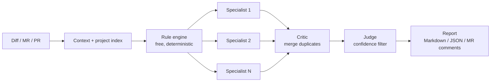

# 🤖 AI Code Review Platform

> Self-hosted, multi-agent AI code review for GitLab merge requests, GitHub pull requests and raw diffs. Bring any LLM provider and keep every review under a hard budget.
>
> ریویوی کد با هوش مصنوعی برای MRهای گیت‌لب، PRهای گیت‌هاب و Diffها؛ روی سرور خودت، با هر سرویس هوش مصنوعی که دوست داری و با سقف هزینه‌ای که خودت تعیین می‌کنی.

**[English](#-english) · [فارسی](#-فارسی) · [Landing page](https://whossein.github.io/ai-platform-review/) · [Changelog](CHANGELOG.md)**

---

## 🇬🇧 English

### What it does

Paste a diff or an MR/PR link. The platform runs free deterministic checks first, then sends the change only to the specialist AI reviewers that match the files you touched. A critic merges duplicate findings, a judge keeps the confident ones, and you get a report you can publish back to the merge request as inline comments.

### Features

**Review pipeline**
- 🤖 **14 specialist reviewers:** React, Next.js, React Native, Angular, Vue, TypeScript, .NET/C#, Python, Android, iOS, Security, Performance, general code quality, and contributing/governance.
- ⚡ **35 built-in rules that cost nothing.** They run before any AI call and only on added lines: hardcoded secrets, SQL injection, wildcard CORS, disabled TLS checks, `eval`, `child_process.exec` with a built-up command, prompt-injection attempts, plus language rules for Python, Java, C#, PHP, Go, Kotlin, Swift, shell and Dockerfiles. Tick **Rules only (no AI)** for an instant, free review. Rule messages follow the comment language (English or Persian).
- 🎯 **Smart routing:** a planner reads the changed files and wakes only the relevant specialists.
- 🛡️ **Hardened prompts:** the diff is treated as data, never as instructions. Docs changed in the MR (`AGENTS.md`, `.cursorrules`…) are reviewed, not obeyed, and injection attempts are reported as critical findings.
- 🧹 **One defect, one finding:** the critic merges reports of the same problem from different specialists. Optionally (`AI_REVIEW_LLM_DEDUP=1`) one cheap AI call also merges same-line findings that are worded differently.
- 🧠 **Index-aware context:** each project keeps a per-branch structural index (exports, imports, dependants), so reviewers see which untouched files a change can break.

**Inputs and outputs**
- 📥 Review a raw diff, a GitLab MR or GitHub PR URL, a ZIP, a local path, or a repository.
- 💬 Publish accepted findings to GitLab MRs or GitHub PRs as inline comments plus a summary (set `GITHUB_TOKEN` / `GITLAB_TOKEN` in Settings).
- 🩹 **AI sample fix:** ask for a corrected snippet on a finding and, for GitLab MRs, commit it to the source branch after confirmation.
- 🔎 **Project scan:** run the built-in rules over every file of a branch and get a filterable report.

**Teams and projects**
- 📁 **Projects** with per-project guidelines. Guidelines are split by heading so each specialist only receives the sections that concern it.
- 🧩 **Per-project review settings (Skills & Rules tab):** managers switch specialists and rules on or off and give each specialist extra instructions. The Security reviewer and security rules can't be switched off for a whole project. Rejecting a rule finding can silence that rule.
- 🔐 **Users and roles:** first-run admin setup, system roles (`ADMIN`, `MEMBER`) and project roles (`OWNER`, `MANAGER`, `REVIEWER`, `VIEWER`), rate-limited login and an append-only audit log.
- 🔑 **Encrypted Git tokens:** personal GitLab/GitHub tokens are stored with AES-256-GCM and never returned by the API.
- 📊 **MR grades and developers:** reviewers grade each MR 0-10 (the system suggests a grade), see per-developer averages, and can estimate how likely an MR was AI-written.

**Cost control**
- 🔌 **Any LLM provider:** Gemini, OpenAI, Anthropic, OpenRouter, DeepSeek, Azure OpenAI, Avalai, Ollama (local), or any OpenAI-compatible gateway. With no key configured it falls back to an offline mock.
- 🔀 **Several providers at once:** each specialist asks for a model tier (`cheap`, `mid`, `premium`), the active default is honored, and a failing provider hands the call to the next one. On HTTP 429 the review waits and retries instead of failing.
- 💰 **Hard budgets** on tokens, dollars and wall-clock time per review, with cheapest-capable model routing, provider prompt caching and a response cache. Models missing from the price table are charged at a cautious fallback rate and the cost is marked as estimated. The cost estimate leaves out specialists a project switched off.

**Also included**
- 🖥️ Electron desktop app.
- 📐 An evaluation harness (`@ai-review/eval`) that scores reviewer precision and recall against ground-truth cases, including real open-source bug fixes: `npm run eval:rules` (offline) and `npm run eval:live` (uses your provider).

Release notes are in [GitHub Releases](https://github.com/whossein/ai-platform-review/releases) (older history in [CHANGELOG.md](CHANGELOG.md)).

### How it works



Specialists run in parallel. Each AI call goes through a router that picks the cheapest model able to do the job; the Security reviewer gets a premium-tier model when one is configured.

### Quick start

Requires **Node.js 18+** and npm 10+.

```bash
git clone https://github.com/whossein/ai-platform-review.git
cd ai-platform-review
npm install
npm run dev
```

Open <http://localhost:4000>. On first run you create the admin account, then add AI provider keys and Git connections under **Settings** (or use the environment variables below).

Forgot the admin password? Stop the server and run `npm run reset-password -- <email> <newPassword>`.

### Configuration

| Variable | Purpose | Default |
| :--- | :--- | :--- |
| `AI_REVIEW_LLM_PROVIDER` | `openai`, `anthropic`, `gemini`, `openrouter`, `deepseek`, `azure`, `avalai`, `ollama`, `custom`, or `mock` | `openai` |
| `AI_REVIEW_<PROVIDER>_API_KEY` | Provider key, e.g. `AI_REVIEW_GEMINI_API_KEY`. Standard names like `GEMINI_API_KEY` / `OPENAI_API_KEY` also work. | none |
| `AI_REVIEW_<PROVIDER>_BASE_URL` | Point a provider at a proxy or gateway | provider default |
| `AI_REVIEW_LLM_API_KEY` / `_BASE_URL` / `_MODEL` | Provider-agnostic fallbacks | none |
| `AI_REVIEW_COMMENT_LANGUAGE` | Default language of review comments (`fa`, `en`, …); can also be chosen per review in the UI | `fa` |
| `AI_REVIEW_TOKEN_BUDGET` / `_DOLLAR_BUDGET` / `_EXECUTION_BUDGET_MS` | Per-review limits | `2000000` / `25` / `600000` |
| `AI_REVIEW_LLM_CACHE` | Set `0` to disable the AI response cache | on |
| `AI_REVIEW_CACHE_WARMUP` | Set `0` to skip the prompt-cache warm-up call | on |
| `AI_REVIEW_LLM_MAX_CONCURRENCY` | Parallel requests per provider | `4` |
| `AI_REVIEW_LLM_DEDUP` | Set `1` to merge same-line duplicate findings with one cheap AI call | off |
| `AI_REVIEW_GOVERNANCE_RULES` | Set `1` to also check branch names and MR titles | off |
| `GITLAB_TOKEN` / `GITHUB_TOKEN` | Server-level Git tokens (per-user tokens in the app are preferred) | none |
| `GITLAB_BASE_URL` | Self-hosted GitLab URL | `https://gitlab.com` |
| `CREDENTIAL_ENCRYPTION_KEY` | Key for encrypting stored Git tokens. **Set this in production**; otherwise a key is generated in `.data/security.key`. | generated |
| `PORT` | Server port | `4000` |

All runtime data (users, projects, encrypted tokens, review memory) lives in `./.data/`. Back it up, and keep `security.key` with it.

### Scripts

| Command | Description |
| :--- | :--- |
| `npm run dev` | Full-stack dev server with auto-restart on port 4000 |
| `npm run build` | Build all packages and bundle the server to `dist/server.cjs` |
| `npm start` | Run the production build |
| `npm test` | Run all package tests |
| `npm run lint` | Type-check all packages |
| `npm run e2e` | End-to-end smoke test (after `npm run build`) |
| `npm run reset-password` | List users, or reset one user's password |
| `npm run eval:mock` | Run the evaluation harness on synthetic cases |
| `npm run eval:rules` | Score the built-in rules on the eval cases (no AI) |
| `npm run eval:live` | Score a full review with your provider (`--pace-ms <n>` for rate-limited keys) |
| `npm run repo:sync` | Print or `-- --apply` the GitHub description and topics; `-- --check` fails if docs show wrong counts |
| `npm run desktop` | Run the server and the Electron desktop app |
| `npm run build:desktop` | Package the desktop app for macOS, Windows, or Linux |

### Project structure

```
apps/
  web/               React + Vite UI
  api/               Auth, users, projects, security
packages/
  orchestrator/      Review pipeline: planner, specialists, critic, judge
  workflow-engine/   DAG stage executor
  agent-runtime/     Agent registry and capability-gated runtime
  llm/               Provider adapters, routing, budgets, caches
  config/            Rule engine and built-in rules
  project-index/     Per-branch structural repository index
  context-engine/    Context extraction and slicing
  git/               GitLab/GitHub access, MR URL parsing, publisher
  repository/        Unified diff parser
  reporting/         Markdown and JSON renderers
  memory/            Durable multi-scope memory
  skills/ tools/     Diff, import, symbol and filesystem helpers for agents
  eval/              Offline evaluation harness
  core/ shared/      Domain types, contracts and utilities
  prompts/ ui/ plugins/   Reserved for future work
server.ts            Express server used by `npm run dev` / `npm start`
main.cjs             Electron main process
```

---

<div dir="rtl">

## 🇮🇷 فارسی

### این پروژه چیه؟

یه ابزار ریویوی کد با هوش مصنوعیه که روی سرور خودت اجرا می‌شه. یه Diff یا لینک MR/PR بهش می‌دی؛ اول خودش با چندتا قانون ساده و رایگان کد رو چک می‌کنه، بعد فقط ریویوکننده‌هایی رو صدا می‌زنه که به فایل‌های تغییرکرده‌ت ربط دارن. آخرش یافته‌های تکراری رو یکی می‌کنه، موردهای مطمئن رو نگه می‌داره و یه گزارش تمیز تحویلت می‌ده که می‌تونی مستقیم به‌شکل کامنت روی MR بذاری.

### چه کارهایی می‌کنه؟

**ریویو**
- 🤖 **۱۴ تا ریویوکننده‌ی متخصص** داره: برای React، Next.js، React Native، Angular، Vue، TypeScript، ‏.NET/C#‏، Python، Android، iOS، امنیت، پرفورمنس، کیفیت کلی کد و قوانین تیم.
- ⚡ **۳۵ تا قانون رایگان** قبل از هوش مصنوعی اجرا می‌شن و فقط خط‌های جدید رو می‌بینن؛ مثلاً کلید API لو رفته، SQL Injection، ‏`eval`، یا کامنتی که بخواد هوش مصنوعی رو گول بزنه. اگه فقط همینا رو می‌خوای، تیک **Rules only (no AI)** رو بزن: فوریه و هیچ هزینه‌ای نداره. پیام این قانون‌ها هم مثل کامنت‌ها فارسی یا انگلیسیه.
- 🎯 فقط ریویوکننده‌هایی که لازمن صدا زده می‌شن، پس هم سریع‌تره هم ارزون‌تر.
- 🛡️ اگه کسی توی کد یا مستندات MR بخواد به هوش مصنوعی دستور بده، اون دستور اجرا نمی‌شه و به‌عنوان یه مشکل جدی گزارش می‌شه.
- 🧹 اگه چندتا ریویوکننده یه مشکل رو گزارش کنن، یه بار نشونت می‌ده. اگه `AI_REVIEW_LLM_DEDUP=1` رو بذاری، یه درخواست ارزون به هوش مصنوعی هم یافته‌هایی رو که توی یه خط هستن ولی جور دیگه نوشته شدن یکی می‌کنه.
- 🧠 ساختار پروژه‌ت رو می‌شناسه (کدوم فایل کدوم رو import کرده)، پس می‌فهمه تغییرت ممکنه کدوم فایل‌های دیگه رو خراب کنه.

**ورودی و خروجی**
- 📥 می‌تونی Diff، لینک MR گیت‌لب، لینک PR گیت‌هاب، فایل ZIP، یه پوشه روی سیستمت یا یه مخزن بهش بدی.
- 💬 یافته‌هایی که تأیید کردی رو مستقیم روی MR گیت‌لب یا PR گیت‌هاب کامنت می‌کنه. فقط کافیه توکن گیت‌هاب یا گیت‌لب رو توی تنظیمات بذاری.
- 🩹 برای هر یافته می‌تونی ازش بخوای یه نسخه‌ی اصلاح‌شده‌ی کد پیشنهاد بده و اگه خواستی، با تأیید خودت مستقیم روی برنچ MR کامیتش کنه.
- 🔎 می‌تونی کل یه برنچ رو با همون قانون‌های رایگان اسکن کنی.

**تیم و پروژه‌ها**
- 📁 هر پروژه می‌تونه راهنمای مخصوص خودش رو داشته باشه و هر ریویوکننده فقط بخشی رو می‌گیره که به کارش میاد.
- 🧩 توی تب **Skills & Rules** مدیر پروژه می‌تونه ریویوکننده‌ها و قانون‌ها رو برای پروژه‌ش روشن و خاموش کنه و به هر ریویوکننده دستور اضافه بده. ریویوکننده‌ی امنیت و قانون‌های امنیتی برای کل پروژه خاموش نمی‌شن.
- 🔐 کاربر و نقش داره: بار اول یه حساب مدیر می‌سازی، بعد برای هر نفر و هر پروژه سطح دسترسی تعیین می‌کنی.
- 🔑 توکن‌های گیت‌لب و گیت‌هابت رمزنگاری‌شده ذخیره می‌شن و هیچ‌وقت از API بیرون نمی‌آن.
- 📊 می‌تونی به هر MR از ۰ تا ۱۰ نمره بدی (خود سیستم هم یه نمره پیشنهاد می‌ده)، میانگین هر توسعه‌دهنده رو ببینی و حتی تخمین بزنی MR با هوش مصنوعی نوشته شده یا نه.

**هزینه**
- 🔌 با هر سرویسی کار می‌کنه: Gemini، OpenAI، Anthropic، OpenRouter، DeepSeek، Azure، آوال‌ای (Avalai)، Ollama روی سیستم خودت، یا هر Gateway سازگار با OpenAI.
- 🔀 می‌تونی چندتا سرویس رو با هم داشته باشی. هر ریویوکننده مدل مناسب خودش رو می‌گیره و اگه یه سرویس وسط کار خطا بده، کار می‌ره سراغ بعدی. اگه سرویس بگه «زیادی درخواست دادی»، صبر می‌کنه و دوباره امتحان می‌کنه.
- 💰 برای هر ریویو سقف توکن، دلار و زمان می‌ذاری و خودش ارزون‌ترین مدلی رو انتخاب می‌کنه که از پس کار برمیاد. اگه قیمت یه مدل معلوم نباشه، با یه نرخ محتاطانه حساب می‌شه و هزینه «تخمینی» نوشته می‌شه.

تغییرات هر نسخه توی [GitHub Releases](https://github.com/whossein/ai-platform-review/releases) هست (تاریخچه‌ی قدیمی‌تر توی [CHANGELOG.md](CHANGELOG.md)).

### چطوری راهش بندازم؟

فقط Node.js نسخه‌ی ۱۸ به بالا لازم داری. دستورها توی بخش [Quick start](#quick-start) هست. بعد از اجرا برو سراغ `http://localhost:4000`، حساب مدیر رو بساز و از قسمت **Settings** کلیدهای API و اتصال گیت رو وارد کن.

> **چندتا نکته:**
> - کامنت‌های ریویو به‌طور پیش‌فرض **فارسی** هستن. برای عوض کردنش، توی صفحه‌ی ریویو زبان رو انتخاب کن یا `AI_REVIEW_COMMENT_LANGUAGE` رو مثلاً روی `en` بذار.
> - اگه روی سرور واقعی نصبش می‌کنی، حتماً `CREDENTIAL_ENCRYPTION_KEY` رو تنظیم کن و از پوشه‌ی `.data` بکاپ بگیر.
> - رمز مدیر یادت رفت؟ سرور رو خاموش کن و `npm run reset-password` رو بزن.

</div>

---

## 📄 License

No license has been chosen yet. Until one is added, all rights are reserved by the author.
