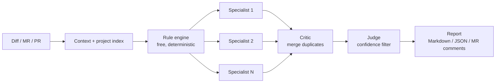

# 🤖 AI Code Review Platform

> Self-hosted, multi-agent AI code review for GitLab merge requests, GitHub pull requests and raw diffs. Bring any LLM provider and keep every review under a hard budget.
>
> بررسی هوشمند و چندعاملیِ کد برای Merge Request های گیت‌لب، Pull Request های گیت‌هاب و Diff ها؛ روی سرور خودتان، با هر سرویس‌دهنده‌ی هوش مصنوعی و با سقف بودجه.

**[English](#-english) · [فارسی](#-فارسی) · [Landing page](https://whossein.github.io/ai-platform-review/) · [Changelog](CHANGELOG.md)**

---

## 🇬🇧 English

### What it does

Paste a diff or an MR/PR link. The platform runs free deterministic checks first, then sends the change only to the specialist AI reviewers that match the files you touched. A critic merges duplicate findings, a judge keeps the confident ones, and you get a report you can publish back to the merge request as inline comments.

### Features

**Review pipeline**
- 🤖 **14 specialist reviewers:** React, Next.js, React Native, Angular, Vue, TypeScript, .NET/C#, Python, Android, iOS, Security, Performance, general code quality, and contributing/governance.
- ⚡ **34 built-in rules that cost nothing.** They run before any AI call and only on added lines: hardcoded secrets, SQL injection, wildcard CORS, disabled TLS checks, `eval`, prompt-injection attempts, plus language rules for Python, Java, C#, PHP, Go, Kotlin, Swift, shell and Dockerfiles. Tick **Rules only (no AI)** for an instant, free review.
- 🎯 **Smart routing:** a planner reads the changed files and wakes only the relevant specialists.
- 🛡️ **Hardened prompts:** the diff is treated as data, never as instructions. Docs changed in the MR (`AGENTS.md`, `.cursorrules`…) are reviewed, not obeyed, and injection attempts are reported as critical findings.
- 🧠 **Index-aware context:** each project keeps a per-branch structural index (exports, imports, dependants), so reviewers see which untouched files a change can break.

**Inputs and outputs**
- 📥 Review a raw diff, a GitLab MR or GitHub PR URL, a ZIP, a local path, or a repository.
- 💬 Publish accepted findings to GitLab as inline discussions plus a summary. GitHub PRs can be reviewed, but publishing back is GitLab-only for now.
- 🩹 **AI sample fix:** ask for a corrected snippet on a finding and, for GitLab MRs, commit it to the source branch after confirmation.
- 🔎 **Project scan:** run the built-in rules over every file of a branch and get a filterable report.

**Teams and projects**
- 📁 **Projects** with per-project guidelines. Guidelines are split by heading so each specialist only receives the sections that concern it.
- 🔐 **Users and roles:** first-run admin setup, system roles (`ADMIN`, `MEMBER`) and project roles (`OWNER`, `MANAGER`, `REVIEWER`, `VIEWER`), rate-limited login and an append-only audit log.
- 🔑 **Encrypted Git tokens:** personal GitLab/GitHub tokens are stored with AES-256-GCM and never returned by the API.
- 📊 **MR grades and developers:** reviewers grade each MR 0-10 (the system suggests a grade), see per-developer averages, and can estimate how likely an MR was AI-written.

**Cost control**
- 🔌 **Any LLM provider:** Gemini, OpenAI, Anthropic, OpenRouter, DeepSeek, Azure OpenAI, Avalai, Ollama (local), or any OpenAI-compatible gateway. With no key configured it falls back to an offline mock.
- 💰 **Hard budgets** on tokens, dollars and wall-clock time per review, with cheapest-capable model routing, provider prompt caching and a response cache.

**Also included**
- 🖥️ Electron desktop app.
- 📐 An offline evaluation harness (`@ai-review/eval`) that scores reviewer precision and recall against ground-truth datasets.

Version-by-version details are in [CHANGELOG.md](CHANGELOG.md).

### How it works



Specialists run in parallel. Each AI call goes through a router that picks the cheapest model able to do the job; the Security reviewer gets a premium-tier model when one is configured.

### Quick start

Requires **Node.js 18+** and npm 10+.

```bash
git clone https://github.com/whossein/ai-platform-review.git
cd ai-platform-review
npm install
npm run dev
```

Open <http://localhost:4000>. On first run you create the admin account, then add AI provider keys and Git connections under **Settings** (or use the environment variables below).

Forgot the admin password? Stop the server and run `npm run reset-password -- <email> <newPassword>`.

### Configuration

| Variable | Purpose | Default |
| :--- | :--- | :--- |
| `AI_REVIEW_LLM_PROVIDER` | `openai`, `anthropic`, `gemini`, `openrouter`, `deepseek`, `azure`, `avalai`, `ollama`, `custom`, or `mock` | `openai` |
| `AI_REVIEW_<PROVIDER>_API_KEY` | Provider key, e.g. `AI_REVIEW_GEMINI_API_KEY`. Standard names like `GEMINI_API_KEY` / `OPENAI_API_KEY` also work. | none |
| `AI_REVIEW_<PROVIDER>_BASE_URL` | Point a provider at a proxy or gateway | provider default |
| `AI_REVIEW_LLM_API_KEY` / `_BASE_URL` / `_MODEL` | Provider-agnostic fallbacks | none |
| `AI_REVIEW_COMMENT_LANGUAGE` | Default language of review comments (`fa`, `en`, …); can also be chosen per review in the UI | `fa` |
| `AI_REVIEW_TOKEN_BUDGET` / `_DOLLAR_BUDGET` / `_EXECUTION_BUDGET_MS` | Per-review limits | `2000000` / `25` / `600000` |
| `AI_REVIEW_LLM_CACHE` | Set `0` to disable the AI response cache | on |
| `AI_REVIEW_CACHE_WARMUP` | Set `0` to skip the prompt-cache warm-up call | on |
| `AI_REVIEW_GOVERNANCE_RULES` | Set `1` to also check branch names and MR titles | off |
| `GITLAB_TOKEN` / `GITHUB_TOKEN` | Server-level Git tokens (per-user tokens in the app are preferred) | none |
| `GITLAB_BASE_URL` | Self-hosted GitLab URL | `https://gitlab.com` |
| `CREDENTIAL_ENCRYPTION_KEY` | Key for encrypting stored Git tokens. **Set this in production**; otherwise a key is generated in `.data/security.key`. | generated |
| `PORT` | Server port | `4000` |

All runtime data (users, projects, encrypted tokens, review memory) lives in `./.data/`. Back it up, and keep `security.key` with it.

### Scripts

| Command | Description |
| :--- | :--- |
| `npm run dev` | Full-stack dev server with auto-restart on port 4000 |
| `npm run build` | Build all packages and bundle the server to `dist/server.cjs` |
| `npm start` | Run the production build |
| `npm test` | Run all package tests |
| `npm run lint` | Type-check all packages |
| `npm run e2e` | End-to-end smoke test (after `npm run build`) |
| `npm run reset-password` | List users, or reset one user's password |
| `npm run eval:mock` | Run the evaluation harness on synthetic cases |
| `npm run desktop` | Run the server and the Electron desktop app |
| `npm run build:desktop` | Package the desktop app for macOS, Windows, or Linux |

### Project structure

```
apps/
  web/               React + Vite UI
  api/               Auth, users, projects, security
packages/
  orchestrator/      Review pipeline: planner, specialists, critic, judge
  workflow-engine/   DAG stage executor
  agent-runtime/     Agent registry and capability-gated runtime
  llm/               Provider adapters, routing, budgets, caches
  config/            Rule engine and built-in rules
  project-index/     Per-branch structural repository index
  context-engine/    Context extraction and slicing
  git/               GitLab/GitHub access, MR URL parsing, publisher
  repository/        Unified diff parser
  reporting/         Markdown and JSON renderers
  memory/            Durable multi-scope memory
  skills/ tools/     Diff, import, symbol and filesystem helpers for agents
  eval/              Offline evaluation harness
  core/ shared/      Domain types, contracts and utilities
  prompts/ ui/ plugins/   Reserved for future work
server.ts            Express server used by `npm run dev` / `npm start`
main.cjs             Electron main process
```

---

<div dir="rtl">

## 🇮🇷 فارسی

### این پروژه چه کار می‌کند؟

یک Diff یا لینک MR/PR را وارد کنید. پلتفرم ابتدا بررسی‌های قطعی و رایگان را اجرا می‌کند و سپس تغییرات را فقط به ارزیاب‌های هوش مصنوعیِ مرتبط با فایل‌های تغییرکرده می‌فرستد. یک «منتقد» یافته‌های تکراری را ادغام می‌کند، یک «داور» فقط موارد مطمئن را نگه می‌دارد و گزارشی دریافت می‌کنید که می‌توانید آن را به‌صورت کامنت روی همان Merge Request منتشر کنید.

### ویژگی‌ها

**فرآیند بررسی**
- 🤖 **۱۴ ارزیاب متخصص:** React، Next.js، React Native، Angular، Vue، TypeScript، ‏.NET/C#‏، Python، Android، iOS، امنیت، پرفورمنس، کیفیت عمومی کد و قوانین مشارکت.
- ⚡ **۳۴ قانون داخلی و رایگان** که پیش از هر فراخوانی هوش مصنوعی و فقط روی خطوط اضافه‌شده اجرا می‌شوند: کلیدهای لو رفته، SQL Injection، ‏CORS باز، غیرفعال شدن TLS، ‏`eval`، تلاش برای Prompt Injection و قوانین مخصوص Python، Java، C#‎، PHP، Go، Kotlin، Swift، shell و Dockerfile. با گزینه‌ی **Rules only (no AI)** بررسی فوری و رایگان انجام می‌شود.
- 🎯 **مسیریابی هوشمند:** فقط ارزیاب‌های مرتبط با فایل‌های تغییرکرده فراخوانی می‌شوند.
- 🛡️ **پرامپت‌های مقاوم:** Diff فقط داده است و دستور تلقی نمی‌شود؛ تلاش برای فریب ارزیاب‌ها به‌عنوان یافته‌ی بحرانی گزارش می‌شود.
- 🧠 **آگاه از ساختار پروژه:** برای هر برنچ یک ایندکس ساختاری (export، import و فایل‌های وابسته) نگهداری می‌شود تا اثر تغییر روی فایل‌های دیگر دیده شود.

**ورودی و خروجی**
- 📥 بررسی Diff، لینک MR گیت‌لب یا PR گیت‌هاب، فایل ZIP، مسیر محلی یا مخزن.
- 💬 انتشار یافته‌های تأییدشده به‌صورت کامنت خط‌به‌خط و خلاصه روی گیت‌لب (انتشار روی گیت‌هاب هنوز پشتیبانی نمی‌شود).
- 🩹 **پیشنهاد اصلاح با AI** و امکان Commit مستقیم آن روی برنچ MR در گیت‌لب، پس از تأیید شما.
- 🔎 **اسکن پروژه:** اجرای قوانین داخلی روی همه‌ی فایل‌های یک برنچ با گزارش قابل فیلتر.

**تیم و پروژه‌ها**
- 📁 **پروژه‌ها** با راهنمای اختصاصی؛ هر ارزیاب فقط بخش‌های مرتبط با خودش را دریافت می‌کند.
- 🔐 **کاربران و نقش‌ها:** ساخت حساب مدیر در اولین اجرا، نقش‌های سیستمی و پروژه‌ای، محدودیت تلاش ورود و ثبت رویدادهای امنیتی.
- 🔑 **توکن‌های Git رمزنگاری‌شده** با AES-256-GCM که هرگز از API برگردانده نمی‌شوند.
- 📊 **نمره‌دهی MR و صفحه‌ی توسعه‌دهندگان:** نمره‌ی ۰ تا ۱۰ برای هر MR (با پیشنهاد سیستم)، میانگین هر توسعه‌دهنده و تخمین احتمال نوشته شدن MR با هوش مصنوعی.

**کنترل هزینه**
- 🔌 **هر سرویس‌دهنده‌ای:** Gemini، OpenAI، Anthropic، OpenRouter، DeepSeek، Azure OpenAI، آوال‌ای (Avalai)، Ollama (محلی) یا هر Gateway سازگار با OpenAI.
- 💰 **سقف بودجه** برای توکن، دلار و زمان هر بررسی، همراه با انتخاب ارزان‌ترین مدل مناسب و کش پاسخ‌ها.

جزئیات هر نسخه در [CHANGELOG.md](CHANGELOG.md) آمده است.

### شروع سریع

به **Node.js نسخه‌ی ۱۸ یا بالاتر** نیاز دارید. دستورات نصب در بخش [Quick start](#quick-start) آمده است. پس از اجرا، آدرس `http://localhost:4000` را باز کنید، حساب مدیر را بسازید و کلیدهای API و اتصال‌های Git را از بخش **Settings** وارد کنید.

> **نکته:** زبان پیش‌فرض کامنت‌ها **فارسی** است. می‌توانید در هر بررسی از رابط کاربری یا با متغیر `AI_REVIEW_COMMENT_LANGUAGE` آن را تغییر دهید. در محیط عملیاتی حتماً `CREDENTIAL_ENCRYPTION_KEY` را تنظیم کنید و از پوشه‌ی `.data` نسخه‌ی پشتیبان بگیرید.

</div>

---

## 📄 License

No license has been chosen yet. Until one is added, all rights are reserved by the author.
